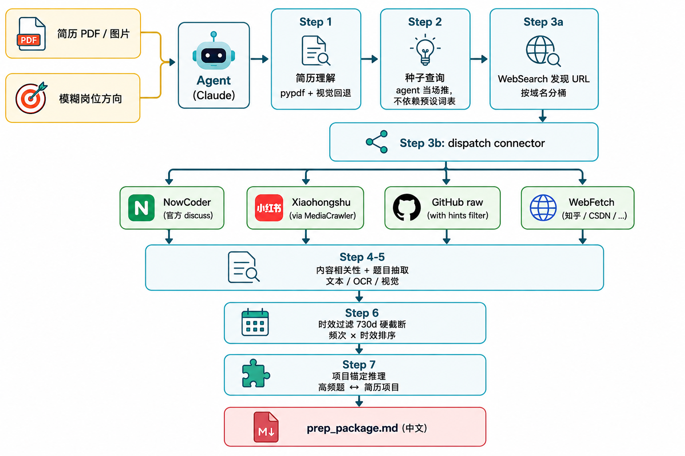

<div align="center">


# InterviewRadar

**Turn a résumé and a rough job target into a source-backed interview prep package.**

[简体中文](README.md) · [English](README.en.md)

[](https://github.com/KunChen1110/InterviewRadar/actions/workflows/tests.yml)
[](LICENSE)
[](requirements.txt)
[](#quick-start)

</div>

InterviewRadar is an agent workflow for **Claude Code or Codex**. Give it a résumé and a broad role, such as “AI application engineer.” It searches public interview accounts, checks the passages behind candidate questions, ranks recurring topics, and connects them to projects on your résumé. The resulting Markdown prep package is **written in Chinese**.

## What you get

| Input | Output |
| --- | --- |
| A text PDF, scanned PDF, or résumé image; a rough job direction | A Chinese prep package with a résumé-to-role gap analysis, ranked questions with source evidence, and follow-up chains tied to your projects |

The questions are meant to be auditable. InterviewRadar keeps source URLs and supporting text, rejects evidence it cannot locate in the source, and labels coverage gaps. It does not treat an agent's plausible-sounding question as proof that someone was actually asked it.

See the [sample prep package](examples/sample_prep_package.md) for the report format.

## Quick start

### Claude Code

Requires [Claude Code](https://claude.ai/code), Python 3.11+, and access to the public sources you want to search.

```bash
# Install as a Claude Code skill
npx -y skills add https://github.com/KunChen1110/InterviewRadar -a claude-code -g

# Install Python dependencies in the skill directory
cd ~/.claude/skills/interview-radar
python3 -m venv .venv
.venv/bin/python -m pip install -r requirements.txt
```

Alternatively, clone this repository into `~/.claude/skills/interview-radar` and run the same Python setup there. Then ask Claude Code:

```text
Use interview-radar with:
Résumé: /path/to/your-resume.pdf
Target role: AI application engineer
```

### Codex

```bash
git clone https://github.com/KunChen1110/InterviewRadar.git
cd InterviewRadar
python3 -m venv .venv
.venv/bin/python -m pip install -r requirements.txt
```

In the repository workspace, ask Codex:

```text
Follow this repository's SKILL.md to run InterviewRadar.
Résumé: /path/to/your-resume.pdf
Target role: AI application engineer
```

The workflow writes the report to `corpus_cache/prep_package.md`. If you are already working in this repository, Codex can read `SKILL.md` directly; no separate skill installation is needed.

## How it works

<div align="center">
  
</div>

1. **Understand the résumé.** Extract text from a PDF, or use vision for scans and images. Identify skills, projects, and relevant terms.
2. **Find interview accounts.** The agent develops search terms from the résumé and target role, discovers public pages, and sends URLs to the appropriate source connectors.
3. **Extract with evidence.** Scripts preserve source passages as candidates. The agent decides which candidates are actual interview questions; the pipeline checks that their evidence exists in the source text.
4. **Filter and rank.** Posts with explicit dates older than 730 days are excluded. Undated material can supplement the results but is ranked lower. Questions are deduplicated and ranked using independent source count and recency.
5. **Make it personal.** The agent links grounded questions to résumé projects and drafts follow-up chains in a Chinese Markdown report.

The agent handles judgment, such as role interpretation and project matching. Python handles repeatable work, such as parsing, evidence checks, date filtering, and ranking. They exchange JSON files in `corpus_cache/`, which makes intermediate decisions inspectable.

## Sources and coverage

| Source | Availability |
| --- | --- |
| NowCoder | Public interview posts, including publication dates when available |
| GitHub | Relevant Markdown interview collections |
| Zhihu, CSDN, and other public blogs | Pages the agent can read directly |
| Xiaohongshu | Optional; requires a separate [MediaCrawler setup](docs/setup/mediacrawler.md) |

The text sources need no extra crawler setup. Coverage still depends on the role, accessible public pages, and each site's access controls. A degraded source is reported rather than silently counted as complete coverage. Xiaohongshu offers a **fast** mode for captions and metadata, and a **deep** mode that also downloads images for OCR; fast mode cannot represent questions that appear only in images. MediaCrawler is for personal, noncommercial use.

InterviewRadar is a research aid, not a guarantee that a question will appear in a future interview. Its output is strongest where multiple accessible, recent accounts support the same topic.

## Repository map

```text
SKILL.md                  Agent workflow and report specification
scripts/resume_extract.py Résumé text extraction and vision fallback
scripts/connectors/      NowCoder, GitHub, and Xiaohongshu connectors
scripts/corpus/          Candidate extraction, evidence checks, recency, ranking
scripts/ocr/             OCR and Xiaohongshu image handling
tests/                   Automated tests
docs/                    Design notes, plans, and source setup
examples/                Sample output
corpus_cache/            Local runtime data and reports (gitignored)
```

For contributors, a new source implements the `Connector` interface in `scripts/connectors/base.py` and returns a `SearchResult`. If a source is unavailable, return a degraded result so the report can explain the gap. The recency and ranking rules live in `scripts/corpus/recency.py` and `scripts/corpus/dedupe_rank.py`.

## Development

```bash
.venv/bin/python -m pytest tests/ -v
```

The repository also includes a reproducible corpus runner: given normalized posts and explicit extraction decisions, it produces ranked questions, rejected items, diagnostics, and a SHA-256 manifest. The runner does not perform browser collection or write the final prose report.

Planned work includes a Douyin source prototype, a persistent role-term lexicon, and a golden-set evaluation workflow. See the [Chinese README](README.md#roadmap) for the full roadmap.

## Responsible use and license

Keep real résumés and generated reports local. `corpus_cache/` and PDF files are ignored by Git, but check your own files before publishing a fork. You are responsible for complying with source-site rules when collecting data; see the [disclaimer](DISCLAIMER.md).

The project is licensed under [MIT](LICENSE). © 2026 Kun Chen.
