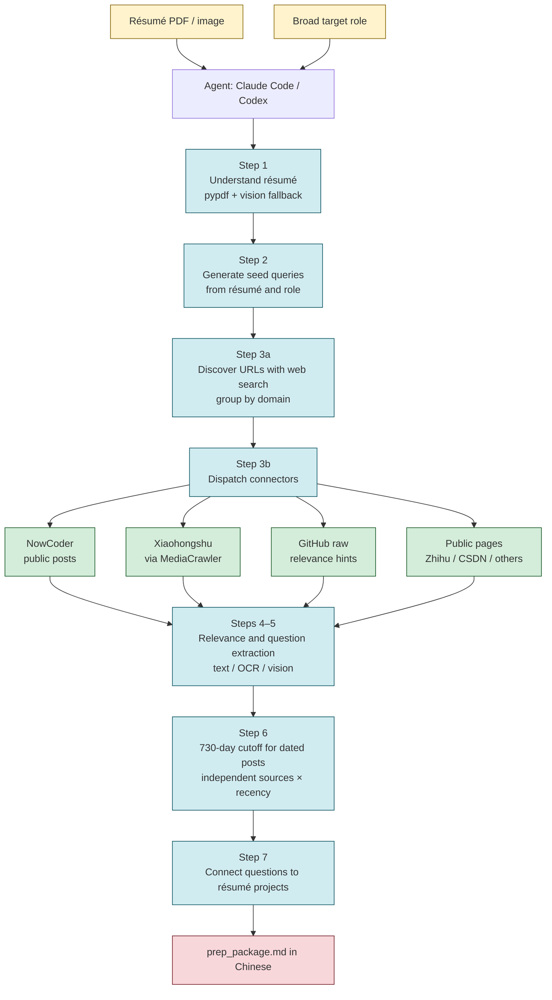

<div align="center">


# InterviewRadar

**Build a personalized Chinese interview prep package from your résumé and real interview accounts.**

[简体中文](README.md) · [English](README.en.md)

[](https://github.com/KunChen1110/InterviewRadar/actions/workflows/tests.yml)
[](LICENSE)
[](requirements.txt)
[](#quick-start)

</div>

---

## The problem

Interview question banks are static. Interviews are shaped by the role, the current hiring market, and the projects on *your* résumé. Public interview accounts are useful, but finding the recent questions relevant to you takes time. An LLM can draft plausible questions in seconds, yet a plausible question is not evidence that anyone was actually asked it.

InterviewRadar is a workflow for **Claude Code or Codex**. It searches public interview accounts, verifies the source passages behind candidate questions, ranks recurring topics, and connects the strongest questions to your own projects.

| You provide | InterviewRadar does | You get |
| --- | --- | --- |
| A résumé (text PDF, scan, or image) and a broad target, such as “AI application engineer” or “marketing intern” | Searches NowCoder, GitHub, and public articles; checks source text; excludes explicitly dated posts older than 730 days; ranks by independent sources and recency; links questions to résumé projects | A **Chinese Markdown prep package** with a résumé-to-role gap analysis, traceable questions, and project-specific follow-up chains |

The search terms come from the résumé and role at run time rather than a fixed list for one field. The same workflow can therefore be applied outside AI roles, though results depend on available source material.

## See the output

For a résumé with three projects targeting an AI application development role, an excerpt looks like this. The report itself is in Chinese:

```markdown
## 2. 简历 ↔ 岗位 Gap 分析

| 维度 | 现状 | 评级 |
|---|---|---|
| Agent Orchestration | P1 已实现多阶段状态机 | ✅ 强 |
| MCP 协议 | 简历未提 | ❌ 弱 |
| Function Calling 工程细节 | 没专门讲 | ⚠️ 中 |
...

## 4. 个性化项目追问链(锚到你的简历)

### 链 4.1 — 高频题 #3 → P1 多阶段状态机

> Q1: "你 P1 项目里设计了 Understanding → Diagnose → ... 这套状态机,
>      具体是怎么拆解出这六个阶段的?"
> Q2: "这套流程对应 ReAct / Plan-and-Execute / Reflexion 里的哪种范式?"
> Q3: "哪个阶段最容易出问题?你是怎么调的?"
```

See the [full sample prep package](examples/sample_prep_package.md).

## Quick start

### Claude Code

You need [Claude Code](https://claude.ai/code) and Python 3.11+. Install the skill with `npx`:

```bash
npx -y skills add https://github.com/KunChen1110/InterviewRadar -a claude-code -g
```

Or clone it manually:

```bash
git clone https://github.com/KunChen1110/InterviewRadar.git ~/.claude/skills/interview-radar
```

Then install the Python dependencies in the skill directory:

```bash
cd ~/.claude/skills/interview-radar
python3 -m venv .venv
.venv/bin/python -m pip install -U pip
.venv/bin/python -m pip install -r requirements.txt
```

Ask Claude Code:

```text
Use interview-radar with:
Résumé: /path/to/your-resume.pdf
Target role: AI application engineer
```

### Codex

Codex can read this repository's `SKILL.md` directly; it does not need the Claude skill installer.

```bash
git clone https://github.com/KunChen1110/InterviewRadar.git
cd InterviewRadar
python3 -m venv .venv
.venv/bin/python -m pip install -U pip
.venv/bin/python -m pip install -r requirements.txt
```

In Codex, from the repository workspace, say:

```text
Follow this repository's SKILL.md to run InterviewRadar.
Résumé: /path/to/your-resume.pdf
Target role: AI application engineer
```

The agent reads the résumé, discovers public source URLs, dispatches them to source connectors, checks evidence and dates, ranks questions, and writes the Chinese report to `corpus_cache/prep_package.md`. If you are already working in this repository, just point Codex to `SKILL.md`.

### Default sources: no extra crawler setup

| Source | What it provides |
| --- | --- |
| NowCoder (牛客) | Interview account posts, with `createTime` when available |
| GitHub | Markdown interview collections |
| Zhihu, CSDN, and other public articles | Page text read by the agent |

Coverage depends on the target role, public access, and each site's anti-bot controls. The report should disclose source degradation instead of quietly treating missing data as complete coverage. A source with no explicit date can supplement the results, but is ranked lower than a recent dated source.

<details>
<summary><b>Optional: add Xiaohongshu (小红书)</b></summary>

Xiaohongshu posts cannot be collected through the default text-source path. Set up [MediaCrawler](https://github.com/NanmiCoder/MediaCrawler) once, then InterviewRadar's connector can invoke it when Xiaohongshu material is needed. You do not have to run a manual export for every search.

```bash
# 1. Install MediaCrawler at the default location
if [ ! -d "$HOME/.mediacrawler" ]; then
  git clone https://github.com/NanmiCoder/MediaCrawler.git ~/.mediacrawler
fi
cd ~/.mediacrawler

python3.11 -m venv venv || python3 -m venv venv
venv/bin/python -m pip install -U pip
venv/bin/python -m pip install -r requirements.txt
venv/bin/python -m playwright install chromium

# 2. In ~/.mediacrawler/config/base_config.py, set:
# LOGIN_TYPE = "cookie"
# COOKIES = "web_session=<your browser's web_session value>"
# ENABLE_CDP_MODE = False
# ENABLE_GET_COMMENTS = False

# 3. Verify the setup
venv/bin/python main.py --platform xhs --lt cookie --type search --keywords "AI应用开发 面经" --save_data_option json --get_comment no
```

A successful run writes a file such as `~/.mediacrawler/data/xhs/json/search_contents_*.json`. If your shell says `pip: command not found`, use the virtual environment's `venv/bin/python -m pip` commands above; a global `pip` install is unnecessary.

| Mode | Content read | Use it for |
| --- | --- | --- |
| `fast` | Title, caption, tags, and publication time | Quick recall and checking that login and search work |
| `deep` | Fast-mode content plus images downloaded in order and read with OCR | A fuller prep package when questions are embedded in images |

The report records which mode was used. A fast-mode run only covers visible text, not questions contained in images. Once configured, the agent can call MediaCrawler through the connector until the login expires.

See the [MediaCrawler setup guide](docs/setup/mediacrawler.md) for details. MediaCrawler is for personal, noncommercial use.

</details>

## How it works

<div align="center">
  
</div>

<details>
<summary>Equivalent Mermaid flowchart (technical details)</summary>



</details>

**Division of work:**

- The agent handles judgment: understanding the role, creating search terms, grouping URLs, deciding which candidates are actual questions, and linking questions to résumé projects.
- Python scripts handle repeatable operations: parsing source material, checking evidence, filtering by date, deduplicating, ranking, and reporting degraded sources.
- They exchange JSON files through `corpus_cache/`, so intermediate inputs and decisions can be inspected or replayed.

## How it differs

| | Static question bank | Questions drafted directly by an LLM | **InterviewRadar** |
| --- | --- | --- | --- |
| Recency | Often mixed or old material | Depends on the prompt | Explicitly dated posts older than 730 days are excluded; undated material ranks lower |
| Personalization | Usually organized by topic, not your résumé | Can sound personal without evidence | Project-linked follow-ups and an `is_grounded` marker |
| Traceability | Sources may exist but are scattered | No source by default | Source URL plus a checked passage from the original text |
| Roles | Usually tailored to one field | Broad | Search terms are generated for the target role at run time |
| Sources | Usually one collection | No retrieval by default | NowCoder, GitHub, public pages; optional Xiaohongshu |

These are workflow differences, not a promise of complete source coverage or a particular interview outcome.

## Repository structure

```text
InterviewRadar/
├── SKILL.md                     Agent workflow and report specification
├── scripts/
│   ├── resume_extract.py        Résumé text extraction and vision fallback
│   ├── connectors/
│   │   ├── nowcoder.py          NowCoder connector, with selector/anti-bot guards
│   │   ├── xiaohongshu.py       Xiaohongshu connector for MediaCrawler exports
│   │   └── github.py           GitHub connector with relevance-hint filtering
│   ├── corpus/
│   │   ├── store.py             RawPost, Question, and audit artifact storage
│   │   ├── recency.py           730-day date filtering
│   │   ├── dedupe_rank.py       Question deduplication and source/recency ranking
│   │   ├── quality.py           Evidence validation and filtering entry point
│   │   └── extraction.py        Source candidates and constrained decisions
│   ├── ocr/
│   │   ├── extract.py           OCR and vision fallback
│   │   └── xhs_images.py        Xiaohongshu image download and OCR assembly
│   └── scrape/normalize_xhs.py  MediaCrawler output normalization
├── tests/                       Automated tests
├── docs/
│   ├── specs/                   Design documents
│   ├── plans/                   Implementation plans
│   └── setup/mediacrawler.md    Xiaohongshu source setup
├── examples/                    Sample output
└── corpus_cache/                Runtime data and reports (gitignored)
```

## Development

```bash
# Run the full test suite
.venv/bin/python -m pytest tests/ -v

# Run a connector's tests
.venv/bin/python -m pytest tests/test_nowcoder_connector.py -v
```

**Add a source:** Implement the `Connector` abstract base class in `scripts/connectors/base.py` and return a `SearchResult`. If a source is unavailable, return `SearchResult.degraded(name, msg)` so the rest of the pipeline can continue and the report can describe the gap.

**Change recency or ranking:** See `scripts/corpus/recency.py` and `scripts/corpus/dedupe_rank.py`. These rules are implemented as testable pure functions.

## Roadmap

- [x] **Live Xiaohongshu collection:** A MediaCrawler cookie-login driver can search by keyword and pass note JSON to `XiaohongshuConnector`.
- [x] **Xiaohongshu normalization:** Native MediaCrawler JSON becomes `RawPost` data with titles, captions, timestamps, and image URLs.
- [x] **Plan 7 — image-based posts:** Images in `image_list` are downloaded in order to `corpus_cache/assets/xhs/{note_id}/`. OCR text becomes the main `RawPost.raw_text/content_text`; title, caption, and tags remain in `locator_text`. Low-confidence OCR can fall back to vision.
- [x] **Question evidence checks:** `QuestionEvidence` stores the source URL and passage. `prepare_questions()` rejects missing, expired, or unlocatable evidence before deduplication and ranking.
- [x] **Plan 8 — source-first question extraction:** `extract_candidates()` produces immutable source-text candidates. The agent decides whether to keep each one and supplies a normalized question, topic, and role tags. `materialize_questions()` builds questions and evidence from those candidates before `prepare_questions()` runs. Candidates and decisions are saved for audit and replay.
- [x] **Plan 9 — reproducible corpus runner and CI:** Given normalized `raw_posts.json` and explicit `extraction_decisions.json`, the runner creates a standalone run bundle with candidates, materialized questions, ranked questions, rejected items, diagnostics, and a SHA-256 manifest. Browser collection, agent decisions, and final report prose remain separate; the final package consumes `ranked_questions.json`.
- [ ] **Plan 10 — Douyin source MVP:** Start with image posts, titles, descriptions, and comments through MediaCrawler. Add a video-ASR interface and degraded-source reporting before full transcription, if the source proves useful for interview accounts.
- [ ] **Persistent term lexicon:** Carry discovered roles, company names, technologies, and frequent terms across sessions to expand future searches.
- [ ] **Evaluation:** Build a golden set and trace replay for OCR, question extraction, ranking, and report quality.

## Contributing

Issues and pull requests are welcome. The repository's development flow is `docs/specs/` → `docs/plans/` → test-driven implementation → two-stage review. The plans in `docs/plans/` show the format used for earlier work.

## Star history

[](https://www.star-history.com/#KunChen1110/InterviewRadar&Date)

## Disclaimer

This project is for personal, noncommercial use. You are responsible for complying with the rules of any source you collect from. See [DISCLAIMER.md](DISCLAIMER.md). Keep real résumés and generated reports local: `corpus_cache/` and PDF files are ignored by Git, but check your own files before publishing a fork.

## License

MIT © 2026 Kun Chen
